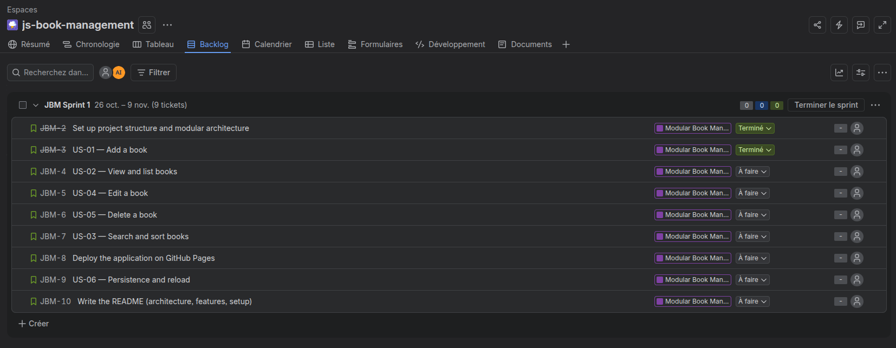
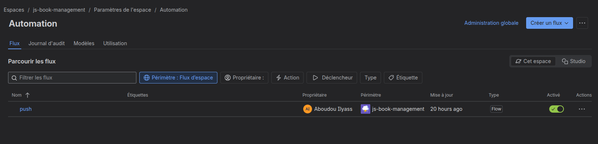

####  Mes Livres

Application web interactive de gestion de bibliothèque personnelle permettant d'ajouter, modifier, supprimer, trier et rechercher des livres, avec persistance des données via le `localStorage`.

#### Fonctionnalités

* **Gestion complète (CRUD) :** Ajout, modification et suppression de livres.
* **Recherche instantanée :** Filtrage dynamique des livres par titre ou auteur (avec gestion d'un délai `debounce`).
* **Tri dynamique :** Tri des livres par titre, auteur ou année de publication.
* **Persistance des données :** Sauvegarde automatique dans le stockage local du navigateur (`localStorage`).
* **Interface moderne :** Design responsive et élégant réalisé avec **Tailwind CSS**.

#### Technologies & Outils

* **Frontend :** HTML5, JavaScript (Modules ES6), Tailwind CSS (CDN)
* **Stockage :** Navigateur LocalStorage
* **Gestion de projet :** **Jira** (avec automatisation des statuts de tickets pour le suivi des tâches)

#### Méthodologie & Gestion de Projet

Le développement de cette application a été structuré à l'aide de **Jira** :
* Découpage du projet en user stories et tâches techniques.
* **Automatisation des flux de travail (Workflow) :** Les statuts des tickets Jira (À faire, Terminé) se sont mis à jour automatiquement selon l'avancement du développement.

